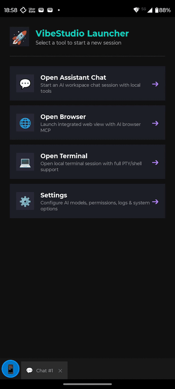
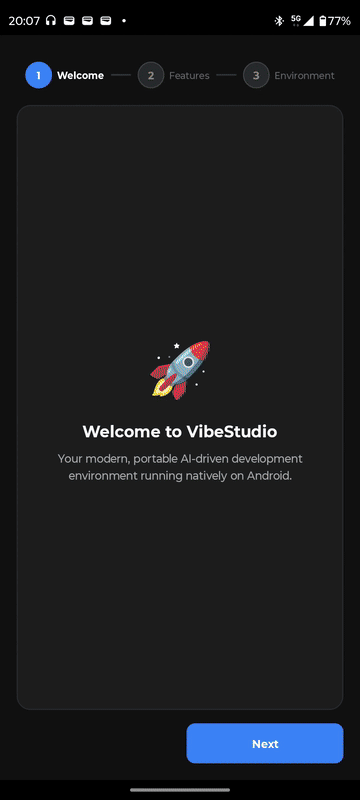

# VibeStudio IDE

## Demo Videos





**VibeStudio IDE** is a native Android application designed to provide a lightweight, self-contained AI-driven development environment directly on mobile devices.

---

## Product Thesis & Non-Negotiables

VibeStudio exists to **replace a PC IDE on your phone — without ever sending your work to a remote server.**

It should feel like *VS Code, but mobile*: you open it, and a full development
environment is simply there. No cloud build box, no account required to run code,
no hidden dependency that phones home. The device is the computer.

**Why on-device only:** remote-dev tools (Codespaces, Replit, Gitpod, …) are a
non-starter for the people who need a mobile IDE most — proprietary code that
can't leave the device, security/compliance rules that forbid cloud build, and
developers who simply won't pay a recurring bill for what their phone can already
run. Serving those users *is* the product; a server-side execution model would
break the one promise that makes VibeStudio worth using.

Non-negotiable principles (every architecture decision is checked against these):

- **No remote execution.** The user's code and builds run **only** on the device.
  Nothing compiles, runs, or is analyzed on our servers — ever.
- **No hidden costs or dependencies.** No mandatory cloud service, no per-use
  metering, no silent third-party backend required for core functionality.
- **Offline-capable by default.** Editing, building, and running work with the
  network off. Model providers are user-chosen and optional.
- **Servers may only ever touch entitlements and *user-initiated* sync** —
  never the user's source, and never the build. If a proposal quietly
  reintroduces a server for execution, it violates the thesis and is rejected.
- **It must feel like a local IDE.** The runtime (proot on F-Droid, an on-device
  VM/emulator on Play) is an implementation detail the user should never have to
  think about. Same environment, same packages, both channels.

---

## Features

- **Models Management**: Interface to configure, monitor, and switch between local or remote AI models.
- **MCP Integration**: Connect and manage Model Context Protocol (MCP) tool providers and services.
- **Built-in Terminal**: Direct terminal interface for executing shell commands and scripts.
- **Built-in Agentic Browser**: Test your work, automate your online actions thanks to WebView with dedicated MCP.
- **Interactive AI Chat**: Chat experience connected with your active AI models and tools.
- **Permissions Management**: Granular control over system permissions and access scopes.
- **Native Stepper Onboarding**: Guided setup walkthrough for first-time app configuration.

---

## Getting Started

### 1. Clone the Repository
VibeStudio uses git submodules for its core terminal functionality (`libtermux-android`). Clone recursively to ensure all components are downloaded:

```bash
git clone --recursive https://github.com/AeonCoreX-Lab/VibeStudio.git
cd VibeStudio
```

If you already cloned without submodules, run:
```bash
git submodule update --init --recursive
```

---

## Building & Development

### 1. In Termux (CLI Build)

#### Step 1: Install Dependencies (One-time setup)
Like `npm install`:
```bash
./install_dependencies_termux.sh
```

#### Step 2: Build the APK
Like `npm start` / `npm run build`:
```bash
./build.sh
```
The compiled, aligned, and signed APK will be created at `bin/VibeStudio.apk`.

---

### 2. In Android Studio (IDE)
1. Open Android Studio.
2. Select **Open** and navigate to the `VibeStudio` root directory.
3. Wait for Gradle sync to finish and click **Run** or **Build APK**.

---

### 3. In VS Code (Gradle + adb)

Prerequisites: a full JDK 17+ with `javac` (the `.vscode` configs use Android Studio's `~/.jdks/jbr-21.0.11`;
a plain `openjdk-*-jre` package is **not** enough and yields "Gradle: Build Error"), Android SDK at `~/Android/Sdk` (set `sdk.dir` in
`local.properties`), and the recommended extensions from `.vscode/extensions.json`
(Java, Gradle, Android for VS Code).

1. Enable **Developer options → USB debugging** (or **Wireless debugging**) on the phone, connect it
   and accept the RSA prompt. Verify with the task **Android: adb devices**. If several devices are
   attached, the tasks pick the one whose `adb devices -l` line contains `TARGET_DEVICE`
   (default `motorola`, set in `.vscode/tasks.json`).
2. Build: `Ctrl+Shift+B` (runs `./gradlew :app:assembleDebug`).
3. Build + install + launch on the phone: **Terminal → Run Task → Android: build + install + run**
   (or **Run Test Task**).
4. Debug: pick **Android: Debug on phone** in the Run and Debug view (`F5`) — it builds, installs
   and attaches the debugger.
5. Logs: task **Android: logcat (VibeStudio only)**.

Tip: keep a single `adb` on your `PATH` (the SDK one in `~/Android/Sdk/platform-tools`). A
different system `adb` (e.g. from `apt`) restarts the server on every call and disconnects
the device.

---

## CI & Releasing

Two GitHub Actions workflows live in `.github/workflows/`:

| Workflow | Trigger | What it does |
|---|---|---|
| `ci.yml` | push / PR to `main` | `:app:assembleDebug`, uploads the debug APK (`VibeStudio-debug-<sha>-aarch64.apk`) as an artifact |
| `release.yml` | push of a `v*` tag | `:app:assembleRelease` signed with the release keystore, verifies the signature, publishes a GitHub Release with `VibeStudio-<version>-aarch64.apk` (+ `.sha256`) and the matching `CHANGELOG.md` section |

### One-time setup: release keystore

The release workflow always signs with the **same keystore**, stored as repository secrets.
Generate it once and keep a backup somewhere safe — if it is lost, users cannot upgrade in place.

```bash
keytool -genkeypair -v \
  -keystore vibestudio-release.jks \
  -alias vibestudio \
  -keyalg RSA -keysize 4096 -validity 10000 \
  -dname "CN=VibeStudio, O=VibeStudio, C=PL"
```

Then add these **Settings → Secrets and variables → Actions → Repository secrets**:

| Secret | Value |
|---|---|
| `RELEASE_KEYSTORE_BASE64` | `base64 -w0 vibestudio-release.jks` |
| `RELEASE_KEYSTORE_PASSWORD` | keystore password chosen above |
| `RELEASE_KEY_ALIAS` | `vibestudio` (or whatever `-alias` you used) |
| `RELEASE_KEY_PASSWORD` | key password (same as the keystore password unless you set a different one) |

With `gh`:

```bash
gh secret set RELEASE_KEYSTORE_BASE64 --body "$(base64 -w0 vibestudio-release.jks)"
gh secret set RELEASE_KEYSTORE_PASSWORD
gh secret set RELEASE_KEY_ALIAS --body vibestudio
gh secret set RELEASE_KEY_PASSWORD
```

Never commit the `.jks` file (`*.jks`, `*.keystore` and `keystore.properties` are git-ignored).

### Local signed release builds (optional)

Create a git-ignored `keystore.properties` in the project root:

```properties
storeFile=/absolute/path/to/vibestudio-release.jks
storePassword=...
keyAlias=vibestudio
keyPassword=...
```

and run `./gradlew :app:assembleRelease`. The same values can be supplied via
`RELEASE_KEYSTORE_FILE`, `RELEASE_KEYSTORE_PASSWORD`, `RELEASE_KEY_ALIAS`, `RELEASE_KEY_PASSWORD`
environment variables (this is what CI uses). Without either, the release build falls back to the
debug key and prints a warning.

### Cutting a release

1. Bump `versionCode` and `versionName` in `app/build.gradle`.
2. Add a `## [X.Y.Z]` section to `CHANGELOG.md` (it becomes the release notes).
3. Commit, then tag and push:
   ```bash
   git tag v0.1.5
   git push origin main v0.1.5
   ```
The workflow fails fast if the tag does not match `versionName`. A tag with a suffix
(e.g. `v0.2.0-beta1`) is published as a pre-release.

Note: this repository uses **immutable releases** — once a tag has been released, that tag name can
never be pushed again (even if the release is deleted). If a release build fails after the release
was created, fix the issue and cut a new patch version instead of re-tagging.

---

## License

Work in Progress.
